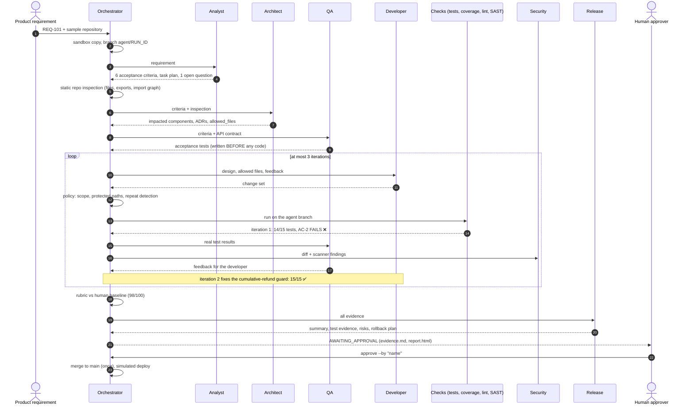
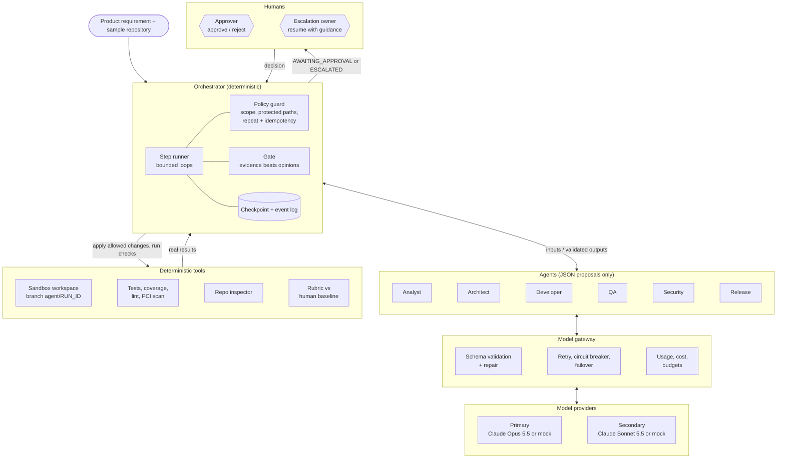
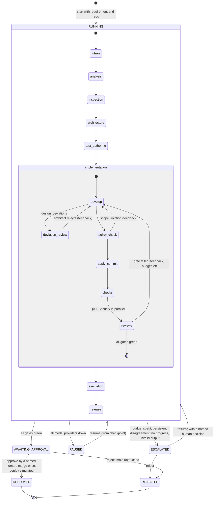
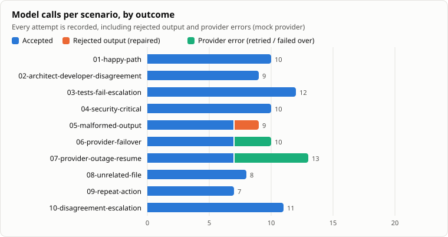
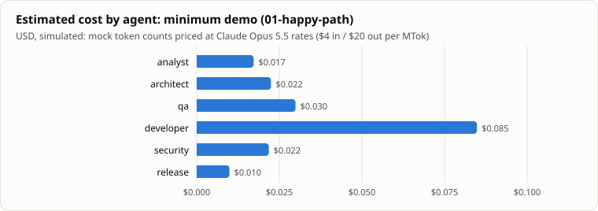
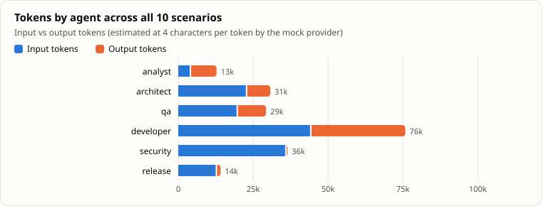

# Autonomous Enterprise Engineering Organisation

**Specialised AI agents take one product requirement from idea to a merge-ready change: analysis, design, code, tests, security review and a release pack. A human still makes the final call on merge and deployment.**

This repository is a working vertical slice built for the *Autonomous Enterprise Engineering Organisation* challenge. A requirement for a payments service ("partial refunds") moves through six agents. Deterministic code checks every agent's output, ten failure scenarios are reproducible offline, and the workflow stops at a human approval gate.

> **Run it in one minute.** You need Node.js 22.18 or newer. No API key, network, database or Docker is needed.
>
> ```bash
> npm run demo        # the minimum demo: one requirement, one failed check, human approval gate
> npm run demo:all    # all 10 scenarios, including every failure case, with a summary table
> npm test            # 34 tests for the orchestrator (unit + end-to-end)
> ```

| | |
|---|---|
| **Agents** | Analyst, Architect, Developer, QA, Security, Release, each with a typed input/output contract |
| **Orchestrator** | Deterministic state machine. It persists a checkpoint after every step and bounds every loop |
| **Gates** | Real `node --test` run, coverage ≥ 80%, lint, PCI-focused static security scan, file-scope policy |
| **Human control** | Merge and deploy happen only through `approve`. Escalations wait for a named human's decision |
| **Observability** | Event log, per-call token, latency and cost records, HTML run report, evidence pack |
| **Failure cases** | All 6 required failure cases plus 4 extra scenarios, each scripted and tested |

---

## Contents

1. [What happens in the minimum demo](#1-what-happens-in-the-minimum-demo)
2. [Architecture](#2-architecture)
3. [The agents and their contracts](#3-the-agents-and-their-contracts)
4. [Workflow state machine](#4-workflow-state-machine)
5. [Failure and exception handling](#5-failure-and-exception-handling)
6. [Where autonomy stops](#6-where-autonomy-stops)
7. [Results and visual data](#7-results-and-visual-data)
8. [Requirement coverage](#8-requirement-coverage)
9. [Running it](#9-running-it)
10. [Project structure](#10-project-structure)
11. [Assumptions, mocks and limitations](#11-assumptions-mocks-and-limitations)
12. [From slice to production](#12-from-slice-to-production)
13. [Further documentation](#13-further-documentation)

---

## 1. What happens in the minimum demo

**Requirement** ([`requirements/REQ-101-partial-refunds.md`](requirements/REQ-101-partial-refunds.md)): merchants need to refund part of a captured payment. Total refunds must never exceed the captured amount, retried requests must not refund twice, every refund must appear in the ledger, and card numbers must never be logged.

**Target repository** ([`sample-repo/payments-service`](sample-repo/payments-service)): a small Node.js payments service with payments, an accounting ledger owned by Finance, settlement, a PAN-redacting logger and its own test suite.



Actual console output (`npm run demo`), abridged:

```text
   analyst   Analyst: 6 acceptance criteria, 6 tasks, 1 open question(s)
             Open questions recorded for the approver (not blocking): Should partial refunds be limited by the
             180-day refund window in config/gateway.config.json? Assumed out of scope for this change.
   architect Architect: 6 impacted components; developer scope = src/refunds.js, src/payments.js, test/refunds.test.js
   qa        QA wrote test/acceptance/refunds.acceptance.test.js before any implementation, covering AC-1 … AC-6
             Iteration 1/3
   developer Developer: Add refund service with amount validation, idempotency keys and REFUND ledger entries
             Applied 3 file(s) on agent/readme-demo at cf1e827
             Checks: tests 14/15 passed, coverage 93.36%, lint 0, SAST 0
❌           Iteration 1 failed: QA: Test "AC-2 cumulative refunds can never exceed the captured amount" failed
             Iteration 2/3
   developer Developer: Add refund service with cumulative-balance guard, per-payment idempotency keys …
             Checks: tests 15/15 passed, coverage 93.36%, lint 0, SAST 0
✅           Iteration 2: all gates green
             Rubric score 98/100 (baseline: 85 lines, candidate: 110 lines)
   release   Release: evidence pack assembled, agent recommends "approve". Waiting for a human.
🧑‍⚖️           All gates passed. Merge and deployment need human approval.

  ▶ A human must decide:  npm run approve -- <runId> --by "<name>" --note "<why>"
```

**The failed check is a real failure.** The first implementation checks each refund against the full payment amount and forgets earlier partial refunds. The developer's own unit tests pass. The QA agent's acceptance test for AC-2, written before any code existed, catches the bug when `node --test` runs. QA turns the failure into feedback and the developer fixes it in the next iteration.

Committed outputs from the real runs are in [`docs/sample-runs/`](docs/sample-runs). Each scenario folder holds `evidence.md` (what the approver reads), `report.html` (visual run report), `events.jsonl` (audit trail), `metrics.json` and `state.json` (the checkpoint).

---

## 2. Architecture



**Design principle: models propose, code disposes.** Agents only ever return JSON proposals. Every proposal is schema-validated, then the orchestrator decides what happens next:

- The orchestrator applies a change only after policy checks pass.
- Pass or fail is decided by real tool results. An agent's opinion about its own work is not enough.
- No agent can merge or deploy.

All six roles could live in one prompt, but separate agents give separation of duties. The developer cannot edit QA's acceptance tests, QA cannot change code, and the release agent cannot approve.

---

## 3. The agents and their contracts

Every output contract is enforced at runtime by [`src/agents/schemas.ts`](src/agents/schemas.ts). Prompts are versioned in [`src/agents/prompts.ts`](src/agents/prompts.ts).

| Agent | Receives | Returns (validated JSON) | Can | Cannot |
|---|---|---|---|---|
| **Analyst** | Raw requirement | `acceptance_criteria[]` (Given/When/Then, `AC-n`), `tasks[]` with owners, `assumptions`, `open_questions`, `out_of_scope` | Shape the scope, flag questions | Design or write code |
| **Architect** | Criteria + static repo inspection | `impacted_components[]`, `approach`, `api_contract`, **`allowed_files`**, `forbidden_files`, ADRs, risks | Set the developer's file scope; rule on deviations | Allow protected paths (policy strips them) |
| **QA** (author) | Criteria + API contract | Acceptance test file under `test/acceptance/`, `criteria_covered` | Write the exam before the code exists | Change source code |
| **Developer** | Design, allowed files with current content, feedback, human guidance | `changes[]` (full file contents), `design_deviations[]`, `tests_added` | Change allowed files; formally disagree | Touch anything else, edit acceptance tests, merge |
| **QA** (reviewer) | Real test, coverage and lint results | `verdict`, `failing_criteria`, `feedback_for_developer` | Turn failures into actionable feedback | Override a failing test |
| **Security** | Diff + static scanner findings | `verdict` (`pass`/`block`), `findings[]` with severity | Block the release path | Downgrade a scanner finding |
| **Release** | Everything above | Title, summary, test evidence, known risks, rollback plan, recommendation | Recommend | Approve, merge or deploy |

---

## 4. Workflow state machine



`state.json` is written atomically (temp file, then rename) after every step and every iteration. Resuming skips completed steps. It also discards half-applied work with `git reset --hard` and uses the idempotency ledger so no side effect happens twice.

---

## 5. Failure and exception handling

Every case in the brief has a scenario that reproduces it offline and an end-to-end test that asserts the outcome.

| # | Failure case (from the brief) | Scenario | Detection | Response | Outcome |
|---|---|---|---|---|---|
| 1 | **Architect and developer agents disagree** | `02-architect-developer-disagreement`, `10-disagreement-escalation` | Developer lists a `design_deviation` to change Finance-owned `src/ledger.js` | Architect reviews it (bounded to 1 round) and rejects with reasons citing ADR-2. The developer complies. If it insists, the run escalates with both positions recorded | 02 continues to approval. 10 → `ESCALATED` → human rules → approval |
| 2 | **Generated code fails tests** | `01-happy-path`, `03-tests-fail-escalation` | Real `node --test` run: QA's acceptance test AC-2 fails | Failure is mapped to its criterion and fed back. At most 3 iterations | 01 is fixed in iteration 2. 03 → `ESCALATED` after 3 attempts |
| 3 | **Security review finds a critical issue** | `04-security-critical` | Scanner rule PCI-001 (payment object with card number logged), confirmed by the security agent | Critical/high findings block the gate whatever the other results; precise fix sent back | Fixed in iteration 2; release path was blocked until then |
| 4 | **Malformed or unsupported output** | `05-malformed-output` | JSON parser (truncated JSON in prose) and schema validator (task assigned to non-existent agent `deploy_bot`) | Re-prompt with the exact validation errors, at most 2 repairs per call, then escalate | Both recovered; nothing invalid reached the workspace |
| 5 | **Provider unavailable mid-workflow** | `06-provider-failover`, `07-provider-outage-resume` | Provider errors classified as retryable (503/429/connection) or fatal (400) | Exponential backoff → circuit breaker → failover to secondary model. If all are down: `PAUSED` with checkpoint | 06 completes on the secondary model. 07 resumes without repeating any completed step |
| 6a | **Workflow modifies an unrelated file** | `08-unrelated-file` | Policy guard: path not in architect's `allowed_files`; also blocks protected paths and `../` escapes | The whole change set is rejected before touching the workspace; developer resubmits within scope | Settlement module untouched |
| 6b | **Workflow repeats an action** | `09-repeat-action`, `01-happy-path` (double approval) | Content hash of each change set; idempotency keys for apply, commit, merge and deploy | Identical change set → no re-apply, no re-test, escalate as "no progress". Second approval → logged, nothing repeated | `ESCALATED`; exactly one merge commit on main |

There is one more guard behind all of these. If an agent says "pass" but the evidence says otherwise, the orchestrator logs `agent.claim_contradicted` and the evidence wins.

---

## 6. Where autonomy stops

The guiding question was: *what is the cost of this decision being wrong, and can it be undone?*

| Decision | Who decides | Why |
|---|---|---|
| Acceptance criteria, task plan | Analyst agent (open questions surfaced to the approver) | Cheap to revise; reviewed at approval |
| Design and file scope | Architect agent, narrowed by policy | Bounded by protected paths that no agent can widen |
| Code changes | Developer agent, **only on an isolated branch** | Nothing reaches `main` without a human |
| Pass/fail of a quality gate | **Deterministic tools** | Agents cannot grade their own work |
| Design disagreement (first round) | Architect agent | Clear ownership, recorded rationale |
| Design disagreement (persists) | **Human** | Cross-team ownership conflicts are organisational decisions |
| Loop exhausted, no progress, invalid output, budget exceeded | **Human** (escalation) | Repeating a failing strategy wastes money and hides the problem |
| Merge to main, deploy | **Human only** (named approver; agent names are refused) | Irreversible, customer-impacting, PCI scope |

**Hard limits** ([`src/config.ts`](src/config.ts)): 3 implementation iterations, 1 deviation round, 2 retries per provider, 2 repair attempts, circuit breaker after 3 consecutive failures, 40 model calls and $2.00 per run, 60 s test timeout, 400-line diff cap.

---

## 7. Results and visual data

These figures come from the actual `npm run demo:all` runs, generated by `npm run charts`. Costs are **simulated**: the mock provider counts tokens as characters ÷ 4 and prices them at Claude Opus 5.5 / Sonnet 5.5 list prices.







<details>
<summary><b>Data tables for the charts</b></summary>

| Scenario | Final status | Iterations | Accepted | Rejected output | Provider errors | Est. cost (USD) | Rubric |
|---|---|---|---|---|---|---|---|
| 01-happy-path | DEPLOYED | 2 | 10 | 0 | 0 | 0.1861 | 98 |
| 02-architect-developer-disagreement | AWAITING_APPROVAL | 2 | 9 | 0 | 0 | 0.1776 | 98 |
| 03-tests-fail-escalation | ESCALATED | 3 | 12 | 0 | 0 | 0.2369 | - |
| 04-security-critical | AWAITING_APPROVAL | 2 | 10 | 0 | 0 | 0.1884 | 98 |
| 05-malformed-output | AWAITING_APPROVAL | 1 | 7 | 2 | 0 | 0.1529 | 100 |
| 06-provider-failover | AWAITING_APPROVAL | 1 | 7 | 0 | 3 | 0.0931 | 100 |
| 07-provider-outage-resume | AWAITING_APPROVAL | 1 | 7 | 0 | 6 | 0.1259 | 100 |
| 08-unrelated-file | AWAITING_APPROVAL | 2 | 8 | 0 | 0 | 0.1691 | 98 |
| 09-repeat-action | ESCALATED | 2 | 7 | 0 | 0 | 0.1607 | - |
| 10-disagreement-escalation | AWAITING_APPROVAL | 3 | 11 | 0 | 0 | 0.2293 | 96 |

| Agent | Calls (01) | Cost USD (01) | Input tokens (all) | Output tokens (all) |
|---|---|---|---|---|
| analyst | 1 | 0.0172 | 4,049 | 8,719 |
| architect | 1 | 0.0225 | 22,788 | 7,935 |
| qa | 3 | 0.0299 | 19,686 | 9,607 |
| developer | 2 | 0.0848 | 44,244 | 31,544 |
| security | 2 | 0.0218 | 35,919 | 543 |
| release | 1 | 0.0099 | 12,711 | 1,416 |

</details>

**What the numbers show**

- **The developer is the cost centre** (about 45% of spend in the minimum demo). It returns whole files, so output tokens dominate. Asking for diffs instead of whole files and prompt-caching the design would lower that.
- **Failover is cheaper, not just safer**. 06 costs about half of 01 because the work moved to the secondary model, which costs half as much per token.
- **Escalation caps cost**. 09 (repeat detected) stops at 7 calls, where letting it loop to the budget would have cost more and achieved nothing.
- **Rubric vs human baseline**. The agent's change is 110 lines against the human reference's 85 (1.29×, inside the 1.5× bar). Both pass all 15 tests.

### Rubric (scored automatically against a human-written baseline)

| Criterion | Max | How it is measured |
|---|---|---|
| Acceptance criteria verified by passing tests | 30 | Each `AC-n` has a QA test that passes |
| Full test suite green | 20 | Regression + developer + acceptance suites |
| No critical/high security findings | 15 | Scanner + security agent, de-duplicated |
| Stayed within the design scope | 10 | Touched files ⊆ `allowed_files` |
| Coverage ≥ 80% | 10 | Node built-in coverage over `src/` |
| Change size vs human baseline | 10 | ≤1.5× full marks, ≤2.5× half |
| Iterations to converge | 5 | 1 → 5, 2 → 3, 3 → 1 |

The baseline ([`scenarios/fixtures/baseline/`](scenarios/fixtures/baseline)) is applied to a clean clone of `main` and run through the same test suites. Both the candidate and the reference are measured by the same tools.

---

## 8. Requirement coverage

| Requirement | Status | Where |
|---|---|---|
| Accept a requirement and a sample repository | ✅ | `run --scenario` or `run --requirement <file> --repo <dir>`; [`sample-repo/`](sample-repo) |
| Generate acceptance criteria and a task plan | ✅ | Analyst, `analyst.clarify` schema |
| Inspect code and identify impacted components | ✅ | [`src/tools/repoInspector.ts`](src/tools/repoInspector.ts) + Architect |
| Generate or modify at least one code path | ✅ | Developer creates `src/refunds.js`, modifies `src/payments.js` |
| Unit tests + at least one additional quality check | ✅ | `node --test`, coverage, lint, PCI static scan |
| Review summary with test evidence and known risks | ✅ | `evidence.md` per run (Release agent + orchestrator) |
| Humans control merge and deployment | ✅ | `approve` / `reject`; merge only from `AWAITING_APPROVAL` |
| *Stretch:* specialised agents with explicit I/O | ✅ | Section 3, runtime-validated schemas |
| *Stretch:* persisted state and execution history | ✅ | `state.json` (atomic checkpoint), `events.jsonl` |
| *Stretch:* hand-offs, retries, bounded iteration | ✅ | Gateway retries, repair loop, iteration and deviation budgets |
| *Stretch:* model usage, latency and cost | ✅ | Every attempt recorded; per-run budgets; HTML report |
| *Stretch:* sandboxing, branch isolation, approval gates | ✅ (partial sandbox) | Per-run workspace copy, `agent/<run>` branch, scrubbed env + timeout for tests. See limitations |
| *Stretch:* compare against a baseline or rubric | ✅ | [`src/eval/rubric.ts`](src/eval/rubric.ts) |

---

## 9. Running it

```bash
npm install                  # only needed for the type-checker and the optional Claude provider
npm run demo                 # 01-happy-path
npm run demo -- 04-security-critical
npm run demo:all             # every scenario, with resume, human guidance and double approval
node src/cli.ts scenarios    # list scenarios
npm run status               # all runs and their state
```

Human actions:

```bash
npm run approve -- <runId> --by "Asha (Release Manager)" --note "evidence reviewed"
npm run reject  -- <runId> --by "Asha" --note "needs the refund window check"
npm run resume  -- <runId>                                    # after an outage (PAUSED)
npm run resume  -- <runId> --by "Priya" --guidance "Side with the architect: keep ADR-2"   # ESCALATED
```

Quality:

```bash
npm run typecheck            # tsc, strict
npm test                     # 34 tests: guardrails, gateway, every scenario end to end
npm run charts               # rebuild README charts from runs/demo-*/metrics.json
```

**With a real model (Claude).** The same orchestrator, gates and limits apply; only the provider changes:

```bash
export ANTHROPIC_API_KEY=...
node src/cli.ts run --provider anthropic --scenario 01-happy-path
node src/cli.ts run --provider anthropic --requirement requirements/REQ-101-partial-refunds.md --repo sample-repo/payments-service
```

The primary model is `claude-opus-5-5` and the secondary is `claude-sonnet-5-5`. Override them with `AEO_PRIMARY_MODEL` / `AEO_SECONDARY_MODEL`. The SDK's own retries are turned off so that the gateway owns retry, failover and accounting. Responses are streamed so long file outputs don't hit timeouts. *The real-model path has been type-checked but not run end to end in this submission. All recorded results use the mock provider.*

---

## 10. Project structure

```text
src/
  cli.ts                  commands: demo, demo-all, run, approve, reject, resume, status
  orchestrator.ts         state machine, steps, gates, escalation, approval
  config.ts               every limit and budget in one place; model pricing
  types.ts                hand-off contracts and workflow state
  agents/schemas.ts       runtime output validation (no dependencies)
  agents/prompts.ts       versioned system prompts per agent task
  llm/gateway.ts          retries, circuit breaker, failover, repair, usage, budgets
  llm/mockProvider.ts     deterministic offline provider with fault injection
  llm/anthropicProvider.ts  Claude via the official SDK (optional)
  tools/workspace.ts      sandbox copy + git branch isolation, path-escape guard
  tools/policy.ts         scope policy, protected paths, change-set hash, idempotency ledger
  tools/checks.ts         test runner, coverage, lint, PCI static security scan
  tools/repoInspector.ts  files, exports, import graph, keyword hits
  eval/rubric.ts          rubric + human baseline comparison
  report/report.ts        evidence.md, report.html, metrics.json
  state/store.ts          atomic checkpoint + append-only event log
scenarios/                10 scenarios, scripted responses, code fixtures, human baseline
sample-repo/payments-service/   target repository (untouched; each run works on a copy)
requirements/             REQ-101
test/                     guardrails, gateway, end-to-end workflow tests
docs/                     architecture, work plan, interview guide, sample runs, charts
reference/exploitos/      prior multi-agent project used as the architectural reference (see Credits)
```

---

## 11. Assumptions, mocks and limitations

**Mocked or simulated**

| Item | What is real | What is mocked |
|---|---|---|
| Model calls | Gateway, validation, retries, failover, accounting | Responses come from a **scripted mock provider** so the demo is deterministic and runs offline. Judgement tasks (QA review, security review, release notes, deviation ruling) are derived from the real evidence passed in; creative tasks (requirements, design, code) are pre-written fixtures |
| Token counts, latency, cost | Accounting and budgets | Tokens ≈ characters ÷ 4; latency is a formula; cost uses Claude list prices. All marked `simulated` |
| Tests, coverage, lint, security scan, git | **All real**, run against real files | - |
| Deployment | Approval, merge on the run's repository, idempotency | "Deploy" writes a record; no environment exists |
| Target repository | Real code with real tests | A small sample service, not a production codebase |

**Assumptions**: one requirement per run; the target repository is JavaScript with `node --test`; amounts are integer paise; reviewers act through the CLI.

**Limitations (honest list)**

- **Sandboxing is process-level, not container-level.** Tests run in a child process with a scrubbed environment, a timeout and an output cap, inside a per-run copy of the repository. Network and filesystem access are not blocked. Production needs a container or microVM with no network.
- **The static security scanner is rule-based.** It catches the patterns it knows (PAN in logs, secrets, eval, shell, weak random). It is a gate, not a substitute for Semgrep/CodeQL plus human review.
- **Repo inspection is lexical.** File index, exports, import graph and keyword hits are enough for a 7-file service. A large monorepo needs a code index (embeddings or a language server).
- **Single process, file-based state.** Fine for one run at a time. Concurrent runs need a database, locking and a queue.
- **The real-model path is untested end to end.** Outputs from a real model will vary, which is exactly what the validator, policy and gates are for.
- **Approval identity is a CLI argument.** Production needs SSO-backed identity, four-eyes rules and signed approvals.

---

## 12. From slice to production

| Next step | Why |
|---|---|
| Run agents as Claude tool-use loops with read/search tools over the repo | Today agents receive context; with tools they could fetch exactly what they need |
| Container sandbox per run (no network, read-only base image) | Real isolation for executing generated code |
| Postgres state + queue + workers | Concurrency, retries across machines, dashboards |
| Open real pull requests instead of local merges; approval = PR review with CODEOWNERS | Use the controls teams already trust |
| OpenTelemetry traces per agent span; Langfuse-style eval dataset | Trend quality and cost per prompt version (as in ExploitOS) |
| Semgrep/CodeQL + dependency scanning in the security gate | Broader coverage than the rule-based scan |
| Prompt caching for the design and repo context; diffs instead of whole files | Cuts the developer agent's cost |
| Policy as code (OPA) for scope and approvals | Auditable, reviewable rules per service |

---

## 13. Further documentation

- [`docs/ARCHITECTURE.md`](docs/ARCHITECTURE.md): component deep dive, data flow, design decisions and trade-offs
- [`docs/WORKPLAN.md`](docs/WORKPLAN.md): the 48-hour plan, milestones and what was cut
- [`docs/INTERVIEW_GUIDE.md`](docs/INTERVIEW_GUIDE.md): a 5-minute pitch, demo script, likely questions with answers
- [`docs/sample-runs/`](docs/sample-runs): evidence packs and HTML reports from every scenario

### Credits

[`reference/exploitos/`](reference/exploitos) is a copy of [HemantKumar01/ExploitOS](https://github.com/HemantKumar01/ExploitOS) (ZeroDayOS). That project is a five-agent AppSec pipeline with typed hand-offs, a JSONL tracer, Langfuse observability and an eval quality gate. It is kept here only as the architectural reference this project grew from. The upstream repository has no license file, so all rights to that code remain with its author. The code under `src/`, `scenarios/`, `sample-repo/`, `test/` and `docs/` was written for this challenge. It keeps ExploitOS's typed hand-offs and trace-everything approach, and adds what that project explicitly does not have: test execution, failure handling, policy guardrails and a human approval gate.
