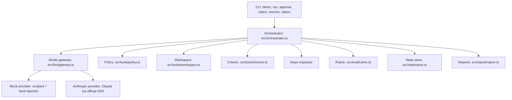
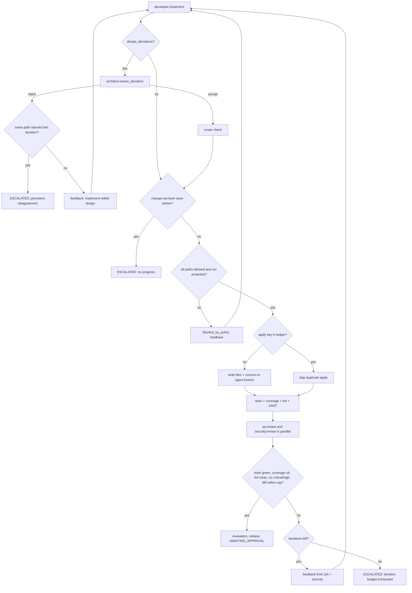
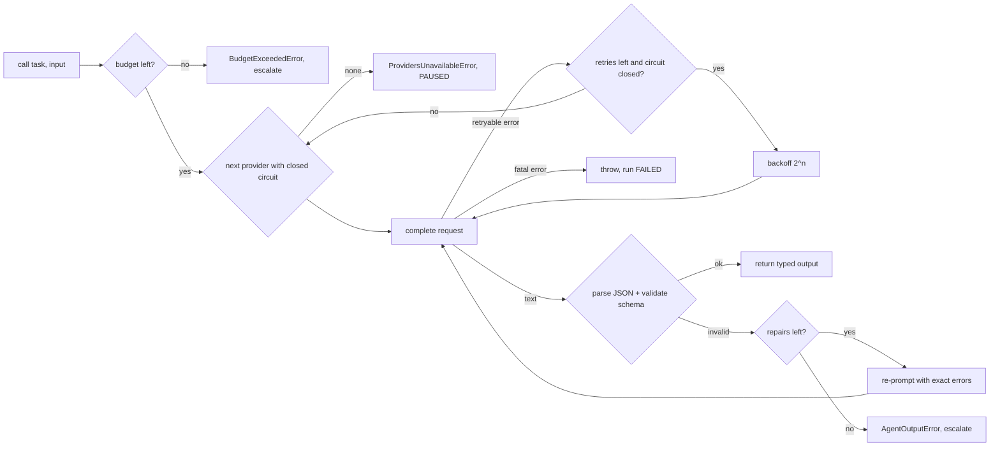

# Architecture deep dive

This document explains how the system is built and why. For the overview, see the [README](../README.md).

## 1. Layers and responsibilities

| Layer | Owns | Never does |
|---|---|---|
| **Orchestrator** | Step order, loop bounds, gates, escalation, approval, checkpoints | Generate content |
| **Agents** (prompt + schema per task) | Proposals: criteria, design, code, reviews, release notes | Touch files, run commands, decide gates |
| **Model gateway** | Retries, circuit breaker, failover, JSON parsing, schema validation, repair, usage/cost, budgets | Know about workflow steps |
| **Policy guard** | Which paths may change, protected paths, change-set hashing, idempotency keys | Call models |
| **Workspace** | Per-run copy, git branch, safe path resolution, commits, diff, merge | Merge without the orchestrator's approval path |
| **Checks** | Test run (child process, timeout, scrubbed env), coverage, lint, security scan | Interpret results "generously" |
| **State store** | Atomic `state.json`, append-only `events.jsonl` | Hold anything not reproducible from the event log + workspace |

## 2. One iteration in detail

The order of checks matters:

1. **Disagreement before repetition.** A developer who repeats a rejected proposal is disagreeing, so the more informative escalation wins.
2. **Repetition before policy.** An identical change set that already failed would fail the same way, so there is no point re-checking or re-running it.
3. **Policy before any write.** A rejected change set never touches the workspace, so there is nothing to roll back.
4. **Deterministic checks before agent reviews.** The reviewers receive the evidence, not a request for an opinion.

## 3. Model gateway

- **Every attempt is a usage record**, including failed and rejected ones. Cost and latency reports therefore include the price of failures.
- **Retryable vs fatal** follows HTTP semantics: 429, 5xx and connection errors are retried; 400-class errors and refusals are not.
- **Circuit breaker**: 3 consecutive failures open the circuit, which stays open for a 30 s cooldown and then lets one trial request through (half-open). While it is open, calls go straight to the next provider without waiting.
- **Repair prompts** quote the validator's exact errors (`$.tasks[6].owner_agent: unsupported value "deploy_bot"`). This is much more effective than "please return valid JSON".

## 4. Persistence and resume

`state.json` contains everything needed to continue: completed steps, agent outputs, iteration records, usage, the idempotency ledger, escalation details and human guidance. It is written to a temporary file and renamed, so a crash leaves either the old checkpoint or the new one, never half of one.

On resume:

1. Completed steps are skipped (their outputs are already in the state).
2. The workspace is reset to the last commit, discarding half-applied files.
3. The gateway is rebuilt with prior usage, so budgets carry over across restarts.
4. Side effects check the idempotency ledger first. If the acceptance tests or a change set were already committed, they are not committed again.

`events.jsonl` is the append-only audit trail: who did what and when, every gate decision and every policy block.

## 5. Security model

| Threat | Control |
|---|---|
| Agent writes outside its scope (other teams' code, CI config, secrets config) | Architect's `allowed_files`, then a global protected list (`.github/`, `config/`, `package.json`, lockfiles, `test/acceptance/`) that no agent can widen; a violation rejects the whole change set |
| Path traversal / symlink escape | Schema regex rejects `..` and absolute paths; the workspace resolves real paths and refuses anything outside the run directory |
| Developer weakens its own tests | Acceptance tests are written by QA before the code and live in a protected path |
| Generated code exfiltrates credentials during tests | Test process gets only `PATH` and `NODE_ENV`; no API keys or tokens are inherited |
| Generated code hangs or floods output | 60 s kill timeout, 2 MB output cap |
| Card data in logs, hardcoded secrets, eval, shell spawning | PCI-focused static scan; critical/high blocks the gate |
| Git hooks or global config in the target repo | `core.hooksPath=/dev/null`, `HOME` and system config ignored for every git call |
| Agent self-approval | `approve` refuses agent role names; only reachable from `AWAITING_APPROVAL` |
| Runaway cost | 40 calls and $2.00 per run, enforced before each call |

**Not covered (see README limitations):** network isolation and kernel-level sandboxing. Those need a container or microVM per run.

## 6. Key design decisions and trade-offs

| Decision | Alternative considered | Why this way |
|---|---|---|
| Deterministic state machine orchestrates; agents do not call each other | Fully autonomous agent swarm / LLM planner | Predictable, testable, auditable. The brief rewards knowing where autonomy should stop |
| QA writes acceptance tests **before** the code | Developer writes all tests | Independent verification; it caught the AC-2 bug that the developer's own tests missed |
| Whole-file outputs from the developer | Unified diffs | Diffs from models often fail to apply; whole files are simpler to validate. Costs more tokens (see README §7) |
| Reject the whole change set on any policy violation | Apply the allowed subset | Partial application produces states nobody reviewed |
| Mock provider with fault injection for the demo | Only a real model | Deterministic, free, offline. Lets every failure path be shown on demand and covered by CI tests |
| Zero runtime dependencies, Node's native TypeScript | Framework (LangGraph etc.) | Every mechanism is visible in about 2,600 lines of TypeScript and can be explained line by line in an interview |
| File-based state | Database | Enough for a vertical slice; the store has one small interface, so swapping it in later is easy |
| Rule-based security scan + agent review | LLM-only review | Rules are reproducible and cannot be talked out of a finding |

## 7. Extending it

- **New agent:** add a schema in `src/agents/schemas.ts`, a prompt in `src/agents/prompts.ts`, a step or call in the orchestrator, and a mock response.
- **New gate:** add a check in `src/tools/checks.ts`, include it in `CheckResults` and in the gate condition.
- **New failure scenario:** add `scenarios/NN-name.scenario.json` with script overrides and faults. It is picked up by `demo-all` and by the end-to-end tests automatically.
- **Another language:** the test runner and lint/scan rules are the language-specific parts; the orchestrator, gateway and policy are not.
