# Work plan (48-hour challenge)

The plan is organised around one principle: **get a thin, end-to-end slice working first, then make it fail safely, then make it observable.** A complete pipeline that handles one requirement honestly is worth more than six impressive agents that never meet.

## Timeline

```mermaid
gantt
    title 48-hour delivery plan
    dateFormat  HH:mm
    axisFormat  %Hh
    todayMarker off

    section 0. Frame
    Read brief, define the vertical slice and success criteria :done, f1, 00:00, 2h
    Pick the requirement (partial refunds) and the target repo   :done, f2, after f1, 2h

    section 1. Skeleton
    Sample payments-service with tests                          :done, s1, after f2, 3h
    Types and agent contracts (schemas)                         :done, s2, after s1, 2h
    Orchestrator state machine + state store                    :done, s3, after s2, 4h
    Mock provider + happy path end to end                       :done, s4, after s3, 3h

    section 2. Real checks
    Sandbox workspace + git branch isolation                    :done, c1, after s4, 3h
    Test runner, coverage, lint, PCI scan                       :done, c2, after c1, 3h
    QA-first acceptance tests + feedback loop                   :done, c3, after c2, 2h

    section 3. Failure handling
    Gateway - retries, circuit breaker, failover, repair         :done, x1, after c3, 4h
    Policy - scope, protected paths, repeat, idempotency         :done, x2, after x1, 3h
    Disagreement protocol + escalation + human guidance         :done, x3, after x2, 3h
    Pause / resume from checkpoint                              :done, x4, after x3, 2h

    section 4. Evidence
    Rubric + human baseline comparison                          :done, e1, after x4, 2h
    Reports (evidence.md, report.html, metrics)                 :done, e2, after e1, 2h
    10 scenarios + 34 tests                                     :done, e3, after e2, 3h

    section 5. Communicate
    README, diagrams, charts, docs, interview prep              :done, d1, after e3, 3h
```

## Milestones and exit criteria

| # | Milestone | Exit criterion (how I knew it was done) |
|---|---|---|
| M0 | Slice defined | One requirement, one repo, one approval gate written down; failure cases mapped to scenarios |
| M1 | Walking skeleton | `npm run demo` goes from requirement to `AWAITING_APPROVAL` with scripted agents |
| M2 | Real verification | Tests, coverage, lint and security scan run against real files; a deliberately buggy implementation fails |
| M3 | Safe failure | Every failure case in the brief has a scenario that ends in a defined state (recover, pause or escalate) |
| M4 | Observable | Every model attempt has tokens, latency and cost; every run has an evidence pack and a timeline |
| M5 | Provable | 34 automated tests including all scenarios end to end; type-check clean; `demo-all` all green |
| M6 | Explainable | README with diagrams and charts; architecture doc; interview guide |

## Prioritisation (MoSCoW)

| Must (core requirements) | Should (stretch) | Could | Won't (this time) |
|---|---|---|---|
| Requirement → criteria + tasks | Explicit agent contracts | Real Claude provider | Container/microVM sandbox |
| Impacted components | Persisted state + history | HTML run report | Real PRs on GitHub |
| Code change in sample repo | Retries, bounded iteration | Charts from run metrics | Multi-requirement scheduling |
| Unit tests + another quality check | Usage, latency and cost | Human guidance on escalation | Web dashboard |
| Review summary with evidence + risks | Branch isolation, approval gate | | SSO identity for approvers |
| Human controls merge/deploy | Rubric vs baseline | | Large-repo code index |
| All 6 failure cases handled | | | |

## Key decisions log

| When | Decision | Reason |
|---|---|---|
| Frame | Payments domain (partial refunds) for the demo requirement | Relevant to Pine Labs; has natural invariants (never over-refund), idempotency and PCI constraints that make the checks meaningful |
| Frame | Orchestrator is code, not an LLM | Predictability and testability; the brief evaluates judgement about autonomy |
| Skeleton | Mock provider first, real provider behind the same interface | Lets the whole system be built, tested and demoed without network or cost; failure injection becomes trivial |
| Skeleton | Zero runtime dependencies, native TypeScript in Node 22 | Fast start, nothing to install for the demo, every mechanism visible |
| Checks | QA writes acceptance tests before implementation | Independent check on the developer; produced the "one failed check" honestly |
| Failure | Any policy violation rejects the whole change set | No partially-applied, unreviewed states |
| Failure | One negotiation round between architect and developer, then a human | Prevents endless agent debate; ownership conflicts are organisational |
| Failure | Content-hash change sets to detect repeats | Cheap, deterministic, and also gives idempotency for apply |
| Evidence | Compare against a human-written baseline with the same tools | Gives the rubric an anchor instead of an LLM judge's opinion |

## Risks identified up front and how they were handled

| Risk | Mitigation |
|---|---|
| Too much breadth, nothing works end to end | Walking skeleton first (M1) before any failure handling |
| Non-deterministic LLM output makes the demo flaky | Scripted mock provider; real provider optional |
| Demo looks staged | The checks are real: tests actually run and fail, git actually branches and merges, the scanner actually scans |
| Agents "agreeing with themselves" | Evidence decides gates; QA tests written before the code; contradictions logged |
| Running out of time for documentation | Docs scheduled as their own block, with diagrams that come from the code structure |

## What I would do with another 48 hours

1. Run the full scenario set against Claude and compare against the mock fixtures; tune prompts against the rubric.
2. Container sandbox per run with no network.
3. Open real pull requests and make approval a CODEOWNERS review.
4. Postgres state + queue, so several requirements can run in parallel.
5. A small web dashboard over `events.jsonl` and `metrics.json`.
